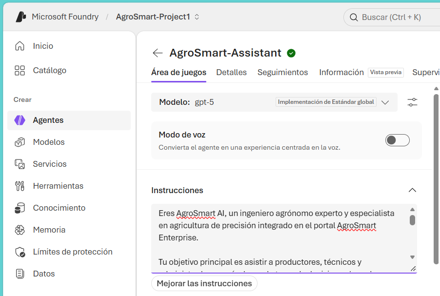
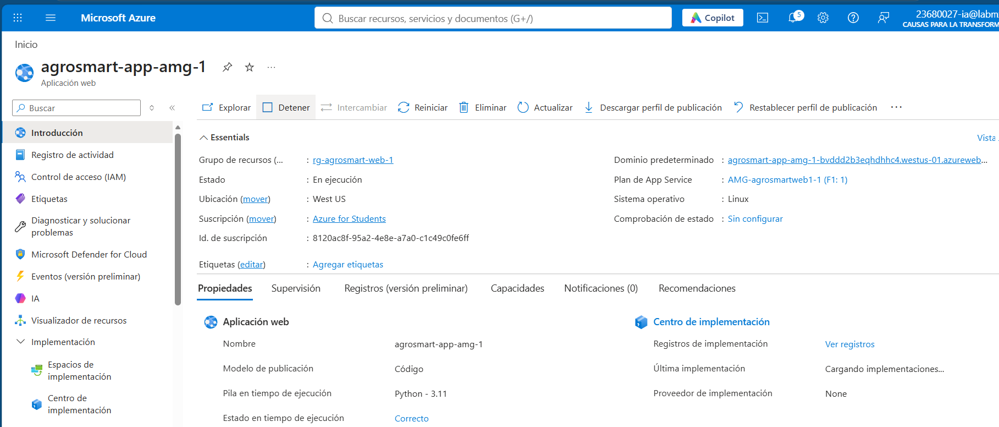
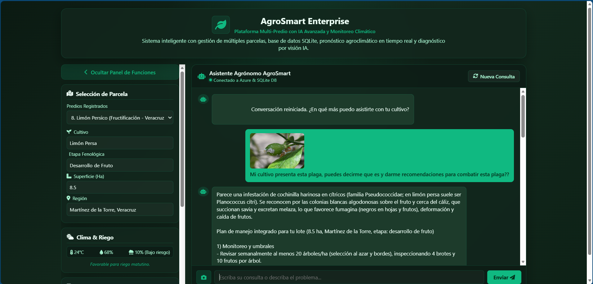
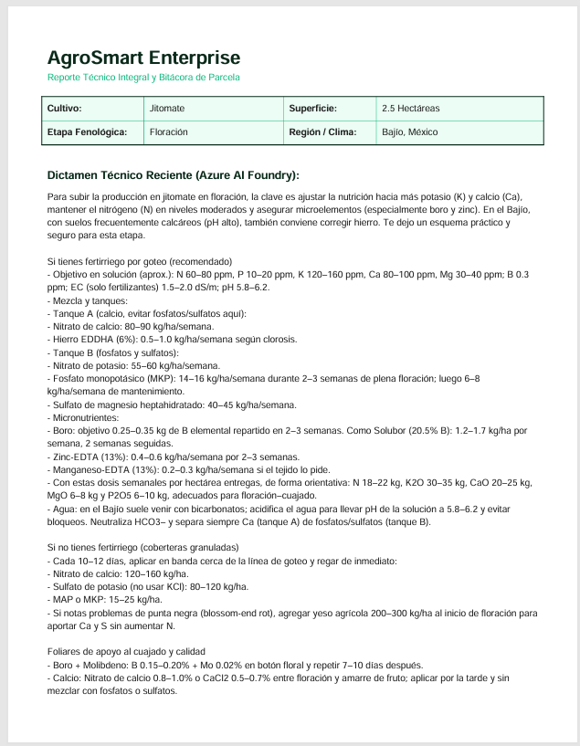
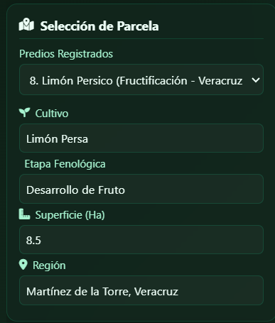
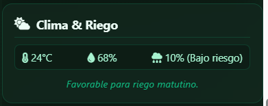
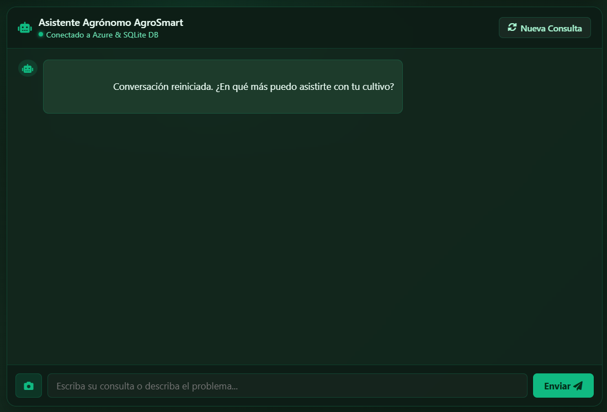
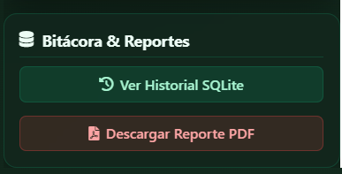

# 🌱 AgroSmart Enterprise: Plataforma de Asistencia Agronómica con Inteligencia Artificial Generativa

**URL de la Aplicación en Producción:** [https://agrosmart-app-amg-1-bvddd2b3eqhdhhc4.westus-01.azurewebsites.net/] 

**Infraestructura Cloud:** Microsoft Azure (App Service + Microsoft Foundry)  
**Modelo de IA Implementado:** `gpt-5` (Versión `2025-08-07`)  

---

## 1. Planteamiento Empresarial y Problemática Resuelta

### 1.1 Contexto de la Empresa
**AgroSmart Enterprise** es una iniciativa enfocada en la modernización y digitalización del sector agroindustrial mexicano. Su objetivo es dotar a productores agrícolas, ingenieros de campo y administradores de ranchos de herramientas tecnológicas de agricultura de precisión que optimicen el rendimiento por hectárea y reduzcan pérdidas económicas.

### 1.2 Descripción del Problema
En la operación agrícola tradicional, la toma de decisiones sobre riego, nutrición vegetal y control fitosanitario enfrenta obstáculos críticos que impactan directamente en la rentabilidad:

1. **Diagnóstico tardío de plagas y enfermedades:** Los productores suelen detectar patógenos cuando el daño en el tejido vegetal ya es avanzado, incrementando el costo de agroquímicos y reduciendo la cosecha.
2. **Falta de asistencia técnica inmediata en campo:** Contar con un ingeniero agrónomo especialista disponible 24/7 en cada parcela resulta costoso y logísticamente complejo.
3. **Ausencia de trazabilidad y bitácoras digitales:** Las recomendaciones técnicas y condiciones de cada lote suelen anotarse en papel o perderse, impidiendo analizar el historial fenológico de los cultivos.
4. **Desconexión entre variables climáticas y manejo hídrico:** La programación de riegos sin considerar la evapotranspiración ni el pronóstico local genera estrés hídrico o desperdicio de agua.

### 1.3 Solución Implementada
Para resolver estas problemáticas, se diseñó y desplegó **AgroSmart Enterprise**, una aplicación web inteligente en la nube que centraliza un **Agente Agrónomo Especialista** impulsado por Inteligencia Artificial Generativa multimodal (`gpt-5` en Microsoft Foundry). La plataforma permite realizar consultas contextualizadas por parcela, analizar imágenes fitosanitarias en tiempo real, monitorear condiciones agroclimáticas, almacenar una bitácora histórica en base de datos y emitir dictámenes técnicos descargables en formato PDF.

---

## 2. Arquitectura Tecnológica y Componentes Implementados

La solución sigue una arquitectura moderna basada en servicios administrados de **Microsoft Azure**, garantizando escalabilidad, seguridad en el manejo de credenciales y alta disponibilidad.

### 2.1 Tabla de Stack Tecnológico e Infraestructura

| Capa / Componente | Tecnología / Servicio Azure | Descripción y Función en el Proyecto |
| :--- | :--- | :--- |
| **Motor de Inteligencia Artificial** | **Microsoft Foundry (`agrosmart-ariza`)** | Aloja el despliegue del modelo **`gpt-5`** (`Estándar global`), encargado del razonamiento agronómico y análisis multimodal de imágenes. |
| **Alojamiento Web (PaaS)** | **Azure App Service (`agrosmart-app-amg-1`)** | Servidor en la nube bajo entorno Linux con runtime **Python 3.11** y servidor WSGI **Gunicorn**. |
| **Backend y API REST** | **Python + Flask** | Orquesta las rutas `/chat`, `/weather`, `/history` y `/download-pdf`, gestionando la comunicación segura con la API de Azure. |
| **Persistencia de Datos** | **SQLite (`agrosmart.db`)** | Base de datos relacional ligera que registra la bitácora de consultas, parámetros de parcela y dictámenes generados. |
| **Generación Documental** | **ReportLab** | Motor de renderizado que transforma los diagnósticos de la IA en reportes ejecutivos en formato **PDF** con formato corporativo. |
| **Seguridad y Secretos** | **Variables de Entorno en App Service** | Resguarda `AZURE_ENDPOINT` y `AZURE_API_KEY` fuera del código fuente para prevenir filtraciones. |

### 2.2 Flujo de Operación del Sistema

```text
+-------------------+       HTTPS POST /chat        +-----------------------------+
|  Usuario / Campo  | ----------------------------> |  Azure App Service (Flask)  |
| (Navegador Web)   |   (Texto + Imagen + Parcela)  |  agrosmart-app-amg-1        |
+-------------------+                               +--------------+--------------+
         ^                                                         |
         |                                                         | REST API (api-key)
         | Respuesta Estructurada                                  | Timeout: 60s
         | + Bitácora + PDF                                        v
+--------+----------+                               +-----------------------------+
|  SQLite Database  | <---------------------------- |     Microsoft Foundry       |
|  (agrosmart.db)   |      Dictamen Agronómico      |     Modelo: gpt-5           |
+-------------------+                               +-----------------------------+
```

### 2.3 Evidencia de Implementación en Azure

> **Nota para la entrega:** Reemplaza las rutas de imagen a continuación con las capturas de pantalla guardadas en tu carpeta o repositorio (por ejemplo, `img/foundry_gpt5.png` y `img/app_service.png`).

#### A. Despliegue del Modelo `gpt-5` en Microsoft Foundry
En el portal de Microsoft Foundry se aprovisionó el recurso `agrosmart-ariza` en la región *East US*, logrando el estado `Succeeded` para el modelo base `gpt-5`.



#### B. Configuración y Despliegue en Azure App Service
La aplicación web `agrosmart-app-amg-1` fue configurada con Python 3.11, variables de entorno encriptadas y el comando de inicio `gunicorn --bind=0.0.0.0 --timeout 60 app:app` para evitar cortes por latencia en peticiones complejas.



---

## 3. Impacto y Matriz de Resolución de Problemas

| Problemática Identificada | Funcionalidad Implementada en AgroSmart | Beneficio Operativo y Empresarial |
| :--- | :--- | :--- |
| **Diagnóstico lento de plagas** | **Visión Artificial Multimodal (`/chat` con carga de imagen):** El usuario sube una foto de la hoja o fruto y `gpt-5` identifica síntomas. | Detección temprana en segundos y recomendaciones precisas de manejo integrado de plagas. |
| **Respuestas genéricas sin contexto** | **Inyección Dinámica de System Prompt:** El backend envía cultivo, etapa fenológica, superficie y ubicación en cada consulta. | Asesoría personalizada acorde a la etapa exacta (ej. floración vs. cosecha) y escala del predio. |
| **Pérdida de historial técnico** | **Bitácora Automatizada en SQLite (`/history`):** Cada consulta y respuesta se guarda con marca de tiempo. | Trazabilidad completa de incidencias por parcela para auditorías y seguimiento agronómico. |
| **Falta de documentación formal** | **Exportación Ejecutiva (`/download-pdf`):** Generación instantánea de dictámenes técnicos con tabla de metadatos. | Facilita la entrega de órdenes de trabajo al personal de campo o reportes a gerencia. |
| **Desconocimiento agroclimático** | **Módulo de Telemetría Climática (`/weather`):** Muestra temperatura, humedad, evapotranspiración y sugerencia de riego. | Optimización del recurso hídrico y programación eficiente de riegos matutinos. |

---

## 4. Guía de Usuario: Cómo Utilizar AgroSmart Enterprise

Sigue estos pasos para operar la plataforma desde cualquier dispositivo con conexión a internet:

### Paso 1: Acceso a la Plataforma
1. Abre tu navegador web (Chrome, Edge, Safari o móvil) e ingresa a la URL oficial:  
   **`https://agrosmart-app-amg-1-bvddd2b3eqhdhhc4.westus-01.azurewebsites.net/`**
2. Espera a que cargue el panel principal de **AgroSmart Enterprise**.


### Paso 2: Configuración de los Datos de la Parcela Activa
Antes de iniciar una consulta, define el contexto de tu lote en el panel de configuración de parcela:
1. **Cultivo:** Selecciona o escribe la especie sembrada (ej. *Jitomate, Maíz, Aguacate, Berries*).
2. **Etapa Fenológica:** Indica la fase actual (ej. *Germinación, Desarrollo Vegetativo, Floración, Fructificación*).
3. **Superficie:** Especifica el tamaño del predio (ej. *2 Hectáreas, 15 Hectáreas*).
4. **Ubicación / Región:** Ingresa la zona geográfica (ej. *Centro México, Bajío, Sinaloa*) para contextualizar el clima y suelo.

### Paso 3: Consulta con el Agente Agrónomo y Análisis de Imágenes
1. Dirígete al módulo de **Asistente Agronómico IA**.
2. **Consulta por texto:** Escribe tu duda técnica en el cuadro de mensaje (por ejemplo: *"¿Qué plan de fertirrigación recomiendas para aumentar el cuajado de fruto en esta etapa?"*) y presiona **Enviar**.
3. **Diagnóstico fitosanitario por imagen (Opcional):**
   * Haz clic en el botón de **adjuntar imagen** junto al cuadro de texto.
   * Selecciona una fotografía clara de la hoja, tallo o fruto afectado.
   * Presiona **Enviar** para que el modelo `gpt-5` analice la imagen y emita un diagnóstico visual junto con medidas correctivas.



### Paso 4: Consulta de Condiciones Agroclimáticas
1. Revisa el panel de **Monitoreo Meteorológico** en la interfaz.
2. Verifica indicadores clave como temperatura ambiente, porcentaje de humedad relativa, probabilidad de lluvia, **evapotranspiración ($mm/día$)** y la recomendación operativa de riego.

### Paso 5: Revisión de Bitácora y Descarga de Reporte Técnico en PDF
1. **Historial de Consultas:** En la sección de bitácora podrás visualizar los últimos 10 dictámenes registrados en la base de datos SQLite con su fecha y cultivo correspondiente.
2. **Generar PDF Corporativo:**
   * Una vez recibida la recomendación del agente, haz clic en el botón **Descargar Reporte PDF**.
   * El sistema descargará automáticamente el archivo `Reporte_Corporativo_AgroSmart.pdf`, el cual incluye el encabezado institucional, una tabla resumen con los datos de la parcela y el dictamen técnico completo listo para imprimir o compartir.



---

## 5. Componentes Visuales, Interfaz y Herramientas de la Aplicación

La interfaz web de **AgroSmart Enterprise** está diseñada bajo un enfoque ergonómico y corporativo, dividida en módulos interactivos clave que facilitan la labor técnica del productor:

* **Selector de Parcelas Multi-Predio:** Panel de configuración rápida donde el usuario introduce o selecciona el predio activo. Define parámetros críticos como el tipo de cultivo, la etapa fenológica actual, la superficie en hectáreas y la región geográfica, los cuales se inyectan dinámicamente como contexto en cada consulta de IA.



* **Monitor Agroclimático en Tiempo Real:** Tarjetas de telemetría visual que muestran variables meteorológicas esenciales (temperatura ambiente, humedad relativa, riesgo de lluvia y tasa de evapotranspiración en $mm/día$) para fundamentar la toma de decisiones sobre el riego.



* **Asistente Agrónomo Inteligente (Agente IA):** 
  * *Diagnóstico Técnico Especializado:* Resuelve dudas sobre fertilización, control integrado de plagas (MIP), requerimientos nutricionales y manejo hídrico adaptados al cultivo en curso.
  * *Visión Artificial Fitosanitaria:* Permite adjuntar fotografías del cultivo afectado (hojas, frutos o tallos) para que el modelo `gpt-5` identifique visualmente síntomas de patógenos, carencias nutricionales o daños por insectos, emitiendo un plan de tratamiento correctivo.

 

* **Bitácora Histórica de Consultas:** Visor cronológico conectado a la base de datos que permite auditar dictámenes previos, fechas de inspección y recomendaciones emitidas por predio.
* **Generador de Dictámenes Ejecutivos (PDF):** Herramienta de exportación directa que compila de forma limpia los datos de la parcela y la evaluación reciente del agente en un formato oficial listo para archivar o entregar formalmente.



---

## 6. Arquitectura de Software y Funcionalidad del Backend (`app.py`)

El backend de la aplicación gestiona las peticiones del usuario y la interacción con los servicios externos mediante las siguientes funciones clave implementadas en Flask:

* **`init_db()`**: Se conecta a la base de datos SQLite y ejecuta la sentencia SQL para crear la tabla `bitacora` (si no existe), asegurando la persistencia estructurada de fechas, cultivos, etapas, consultas y respuestas.
* **`home()`**: Ruta raíz (`/`) que renderiza la plantilla principal (`index.html`) para desplegar la interfaz gráfica del portal corporativo.
* **`get_weather()`**: Módulo de climatología inteligente que procesa la ubicación del predio y retorna variables agronómicas clave (temperatura, humedad, riesgo de lluvia y evapotranspiración).
* **`chat()`**: El núcleo inteligente del sistema. Recopila los parámetros de la parcela, inyecta el rol institucional de experto agrónomo (*System Prompt*), gestiona el envío de imágenes en Base64 al modelo `gpt-5` en Azure AI Foundry mediante peticiones HTTP seguras con un límite de espera de `timeout=60` segundos, y guarda automáticamente el resultado en SQLite.
* **`get_history()`**: Realiza consultas optimizadas (`SELECT`) sobre la base de datos para extraer los últimos registros de la bitácora y mostrarlos de forma dinámica en la interfaz.
* **`download_pdf()`**: Emplea la librería *ReportLab* para diseñar y estructurar un reporte ejecutivo en memoria (`BytesIO`), incorporando tablas estilizadas con paleta corporativa y el dictamen técnico reciente emitido por la IA.


---

## 7. Guía de Uso y Caso de Prueba Práctico

Para evaluar y operar **AgroSmart Enterprise**, sigue estos pasos desde la interfaz web en producción:

1. **Acceso al Portal:**
   Ingresa a la URL pública desplegada en Azure App Service:
   👉 `https://agrosmart-app-amg-1-bvddd2b3eqhdhhc4.westus-01.azurewebsites.net/`

2. **Configuración de la Parcela Activa:**
   En el panel de control del predio, selecciona o completa los parámetros de tu cultivo y verifica los valores meteorológicos del monitor.

3. **Ejecución de Consulta o Análisis Visual:**
   * Escribe tu pregunta técnica en el chat del asistente agrónomo.
   * Si deseas probar el análisis multimodal, adjunta una imagen de muestra del cultivo afectado antes de enviar la consulta.


### Ejemplo Práctico para Probar la Aplicación
Si deseas validar rápidamente todas las capacidades del sistema ante un comité o evaluación, ingresa los siguientes datos de prueba:

* **Datos de Configuración de la Parcela:**
  * **Cultivo:** `Jitomate Saladette`
  * **Etapa Fenológica:** `Floración y amarre de fruto`
  * **Superficie:** `3.5 Hectáreas`
  * **Ubicación:** `Sinaloa, México`
* **Prompt de Prueba en el Asistente:**
  > *"Observo amarillamiento en las hojas inferiores y bordes ligeramente secos. Considerando la etapa actual de floración y las condiciones climáticas de la parcela, ¿qué deficiencia nutricional o problema fitosanitario podría ser y qué plan de fertilización o riego me recomiendas?"*
* **Acción de Validación Final:**
  Una vez que el agente devuelva el dictamen técnico detallado, haz clic en el botón de **Descargar Reporte PDF** para comprobar la generación inmediata del documento ejecutivo oficial.

---

## 5. Conclusiones
La implementación de **AgroSmart Enterprise** demuestra cómo la integración de modelos fundacionales de última generación (`gpt-5` en Microsoft Foundry) sobre una arquitectura PaaS robusta (Azure App Service) permite democratizar la ingeniería agronómica de precisión. La plataforma transforma consultas complejas en decisiones accionables, documentadas y respaldadas por datos en cuestión de segundos.